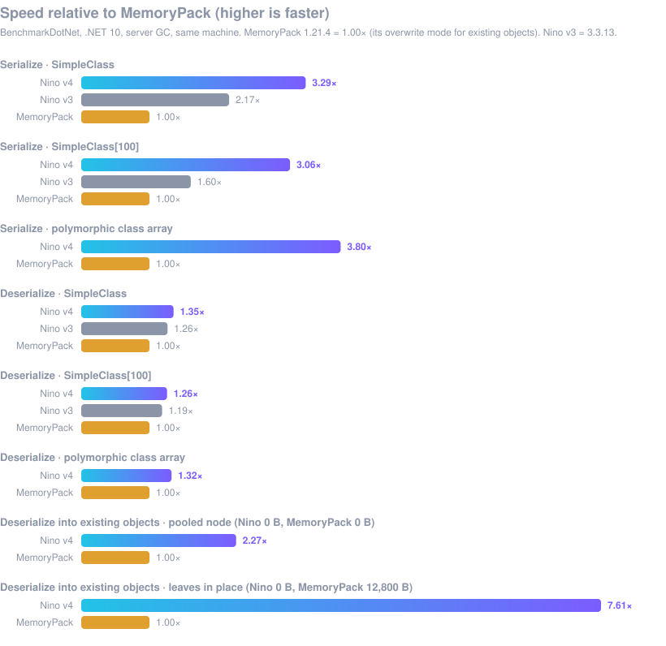

<div align="center">


# Nino

**C# 最快的二进制序列化库。**<br>
源生成、零分配、线程安全，适用于 Unity、Godot 和 .NET 服务端。

[](https://github.com/JasonXuDeveloper/Nino/actions)
[](https://www.nuget.org/packages/Nino)
[](https://openupm.com/packages/com.jasonxudeveloper.nino/)
[](LICENSE)
[](https://deepwiki.com/JasonXuDeveloper/Nino)

[🌐 **官网**](https://nino.xgamedev.net/zh) ·
[🚀 **快速上手**](https://nino.xgamedev.net/zh/docs/v4/start) ·
[**v4 新特性**](https://nino.xgamedev.net/zh/docs/v4/whats-new) ·
[**性能**](https://nino.xgamedev.net/zh/docs/v4/perf) ·
[**对比 MemoryPack**](https://nino.xgamedev.net/zh/docs/v4/vs-memorypack) ·
[**English**](README.md)

</div>

| **4.3×** | **4.9×** | **0 GC** | **289×** |
|:---:|:---:|:---:|:---:|
| 序列化比 MemoryPack 快<br>（多态数组） | 反序列化到已有对象<br>比 MemoryPack 覆盖写入快 | 序列化、复用池化对象反序列化<br>零 GC 分配 | 编译比 v3 快<br>（1,100 个类型：636 秒 → 2.2 秒） |

<p align="center">
  
</p>

<sub>BenchmarkDotNet 0.15.2，.NET 10，Intel Xeon 2.80 GHz，同一台机器、同样大小的数据（`SimpleClass`：Nino 1,146 字节，MemoryPack 1,148 字节）。全部用例与测试方法见 [docs/v4-benchmarks.md](docs/v4-benchmarks.md)。</sub>

## 为什么选 Nino

- **比 MemoryPack 更快。** 序列化快 2.5–4.3 倍；类和多态类型的反序列化快 1.16–1.38 倍；原始结构体数组持平。
- **零分配。** 序列化不分配内存。反序列化到已有对象或池化对象（`[NinoPooled]`、`ref` 反序列化）同样不分配，
  比 MemoryPack 的覆盖写入最多快 4.9 倍。
- **一切在编译期完成。** 源生成器为每个类型生成格式化器：没有反射、没有 IL emit、无需注册、无需初始化调用，
  因此 IL2CPP、NativeAOT 和 HybridCLR 热更都能直接用。使用 .NET 8 及以上 SDK 时，调用会被拦截到确切的格式化器，没有虚调用。
- **编译快。** 生成器是真正增量的：每个类型一个文件，只重新生成你改动的类型。相比 v3，生成代码小 16 倍，编译快 44 倍。
- **线程安全。** 任意多个线程同时序列化、反序列化，热路径上没有锁。
- **数据可以演进。** 版本兼容、keyed 成员、引用追踪（共享引用和循环引用），都按类型按需开启，不用的类型零开销。
- **处处同一格式。** `netstandard2.0`、`netstandard2.1`、`net8.0`、`net10.0` 写出的字节完全一致，Unity 客户端和 .NET 服务端可以直接互通。
- **写代码时就发现错误。** 22 条分析器诊断（NINO001–NINO022），多数带一键修复。

## 适用场景

| | |
|---|---|
| 🎮 **[Unity](https://nino.xgamedev.net/zh/docs/v4/advanced/unity)** | Unity 2022.3+，Mono 和 IL2CPP，HybridCLR 热更程序集。`Vector3`、`Quaternion`、`Color32` 等非托管结构体按原始内存直接拷贝。通过 OpenUPM 安装。 |
| 👾 **[Godot 4（.NET）](https://nino.xgamedev.net/zh/docs/v4/platforms)** | Godot 的 .NET 项目直接引用 NuGet 包。Godot 的数学结构体（`Vector3`、`Transform3D` 等）是非托管类型，按原始内存直接拷贝。 |
| 🌐 **[游戏服务端与网络层](https://nino.xgamedev.net/zh/docs/v4/advanced/networking)** | 直接序列化进 `IBufferWriter<byte>`（`PipeWriter`、池化缓冲区），从 `ReadOnlySpan<byte>` 反序列化，复用池化的消息对象。多态消息无需手写标签。 |
| 💾 **[存档与持久化](https://nino.xgamedev.net/zh/docs/v4/advanced/persistence)** | 版本兼容和 keyed 成员让你在版本之间增加、调整顺序、删除字段；引用追踪保留共享引用和循环引用的对象图。 |
| ⚙️ **[服务、缓存与进程间通信](https://nino.xgamedev.net/zh/docs/v4/advanced/high-performance)** | 紧凑的二进制数据、每次调用零分配，可在 ASP.NET Core、后台任务和 Actor 中安全并发使用。 |

## 安装

> 第一次用 Nino？请看官网的 **[快速上手](https://nino.xgamedev.net/zh/docs/v4/start)**：.NET、Unity 和 Godot 的安装，第一个类型，以及基础用法。

```bash
dotnet add package Nino                # .NET、Godot
dotnet add package Nino.Immutable      # 可选：ImmutableArray<T> / ImmutableList<T>
openupm add com.jasonxudeveloper.nino  # Unity
```

## 快速开始

```csharp
using Nino.Core;

[NinoType]
public class Player
{
    public int Id;
    public string Name;
    public List<Item> Inventory;
}

byte[] bytes = NinoSerializer.Serialize(player);
Player copy = NinoDeserializer.Deserialize<Player>(bytes);
```

### 多态，无需标签

```csharp
[NinoType] public abstract class Message { public int Seq; }
[NinoType] public sealed class Move : Message { public Vector3 To; }
[NinoType] public sealed class Chat : Message { public string Text; }

Message msg = NinoDeserializer.Deserialize<Message>(bytes); // 得到 Move 或 Chat
```

### 零分配网络层

```csharp
// 直接写进 socket 管道，不产生中间 byte[]。
NinoSerializer.Serialize(msg, pipeWriter);

// 复用池化实例（连同它们的列表），而不是每次新建。
[NinoType, NinoPooled]
public sealed partial class Snapshot
{
    public int Tick;
    public List<EntityState> Entities;

    private static partial IEnumerable<Snapshot> OnNinoPoolWarmup() => Enumerable.Range(0, 16).Select(_ => new Snapshot());
    private partial void OnNinoPoolReturn() { }
}

var snapshot = NinoDeserializer.Deserialize<Snapshot>(span); // 从池中取出
// ... 使用 ...
snapshot.ReturnToPool();
```

### 会变化的数据

```csharp
[NinoType(keyed: true)]            // 按成员名匹配：可以增加、调整顺序、删除成员
public class SaveGame { public int Level; public string Hero; }

[NinoType(trackReferences: true)]  // 共享引用和循环引用在往返后保持不变
public class Node { public string Name; public List<Node> Links; }
```

**[在官网 nino.xgamedev.net 阅读文档 →](https://nino.xgamedev.net/zh/docs/v4/start)**，包括高性能序列化、网络层、存档和 Unity 的
[高级用法](https://nino.xgamedev.net/zh/docs/v4/advanced)。

## Nino 与 MemoryPack

| | Nino v4 | MemoryPack 1.21.4 |
|---|---|---|
| 序列化 | **快 2.5–4.3 倍** | |
| 反序列化类和多态类型 | **快 1.16–1.38 倍** | |
| 反序列化原始结构体数组 | 持平 | 持平 |
| 反序列化到已有对象 | **0 B，最多快 4.9 倍**（池化） | 覆盖写入，有分配 |
| 多态 | 自动类型 ID | 需要维护 `[MemoryPackUnion]` 标签 |
| keyed 成员、引用追踪、对象池 | ✅ | 有版本兼容和循环引用，没有对象池 |
| Unity | 2022.3+，`netstandard2.0` 和 `2.1`，HybridCLR | `netstandard2.1` |

MemoryPack 内置支持的类型更多（`BigInteger`、`Uri`、全部不可变集合、`AnimationCurve` 等 Unity 类），还有 TypeScript 生成和
ASP.NET Core 格式化器。流、异步读写、多段 `ReadOnlySequence<byte>` 输入、回调和压缩，只需在 Nino 的 `IBufferWriter<byte>`
和 `ReadOnlySpan<byte>` API 外包几行代码，[完整对比](https://nino.xgamedev.net/zh/docs/v4/vs-memorypack)里有示例。
MemoryPack 的 Union 标签是 1 字节，Nino 的类型 ID 是 4 字节，这是有意的取舍：类型 ID 由类型本身算出，子类不用打标签，
可以定义在任何程序集里（插件、HybridCLR 热更程序集），也不会因为增删子类而重新编号；MemoryPack 的每个 Union 都要手动列出或注册子类。

## v4

v4 重写了运行时和生成器。**二进制格式与 v3 不兼容。**

| v4 对比 v3（3.3.13） | |
|---|---|
| 序列化 | **最高快 1.73 倍**（类 1.73×，类数组 1.29×，结构体 1.35×） |
| 反序列化 | 类**快 1.19–1.22 倍**，原始数组持平 |
| 编译生成代码 | 330 个类型**快 44 倍**（56 秒 → 1.3 秒），1,100 个类型**快 289 倍**（636 秒 → 2.2 秒） |
| 运行生成器 | **快 7.9 倍**；改动后只重新生成该类型 |
| 生成代码 | 源码**小 16 倍**，IL **小 6 倍** |

v4 新增：拦截器、keyed 成员、引用追踪、`[NinoPooled]` 对象池、可插拔格式化器（`[assembly: NinoFormatter(...)]`）、
自定义集合类型、分析器与代码修复，以及所有目标框架字节一致。详见 [v4 新特性](https://nino.xgamedev.net/zh/docs/v4/whats-new)
和[迁移指南](https://nino.xgamedev.net/zh/docs/v4/migration)；内部设计见 [docs/v4-design.md](docs/v4-design.md)。

## 参与贡献

欢迎提交 Issue 和 Pull Request。构建、测试矩阵和发布流程见 [CONTRIBUTING.md](CONTRIBUTING.md)。

<div align="center">

[MIT License](LICENSE) · 作者 [JasonXuDeveloper](https://github.com/JasonXuDeveloper)

</div>
