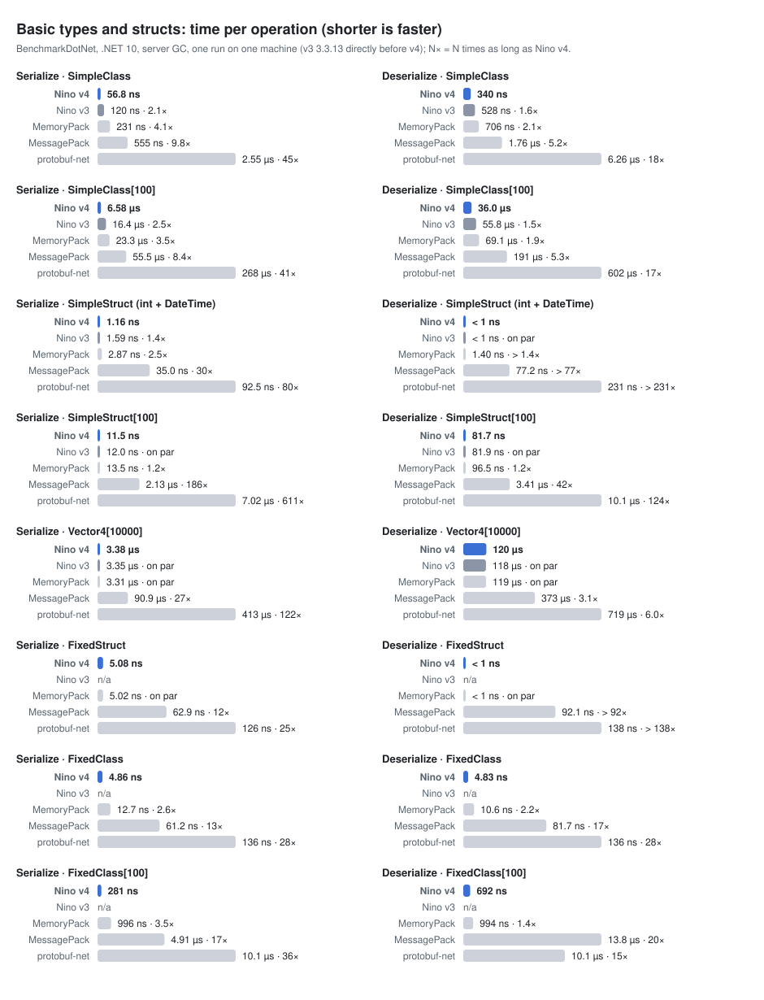
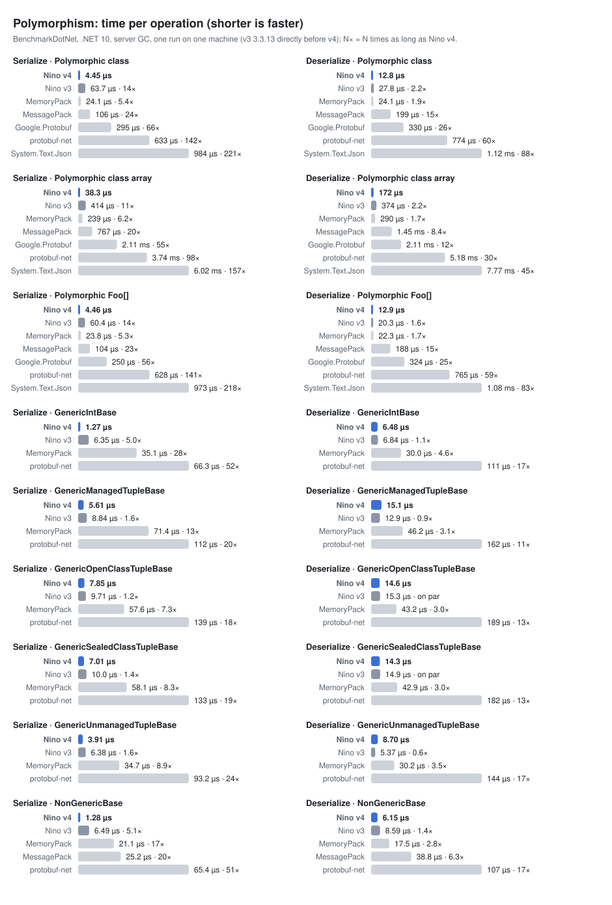
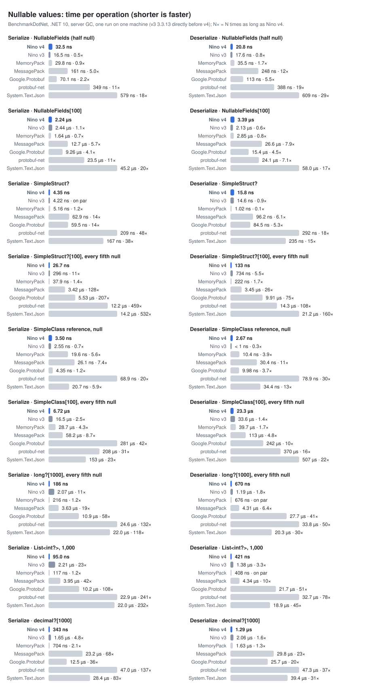
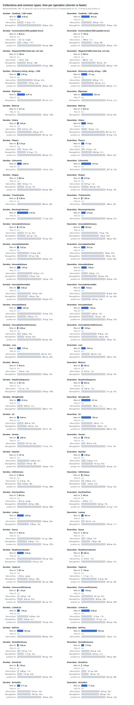
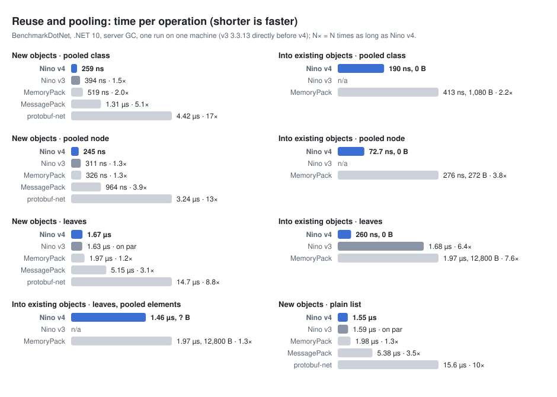
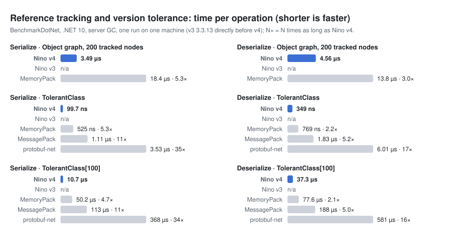
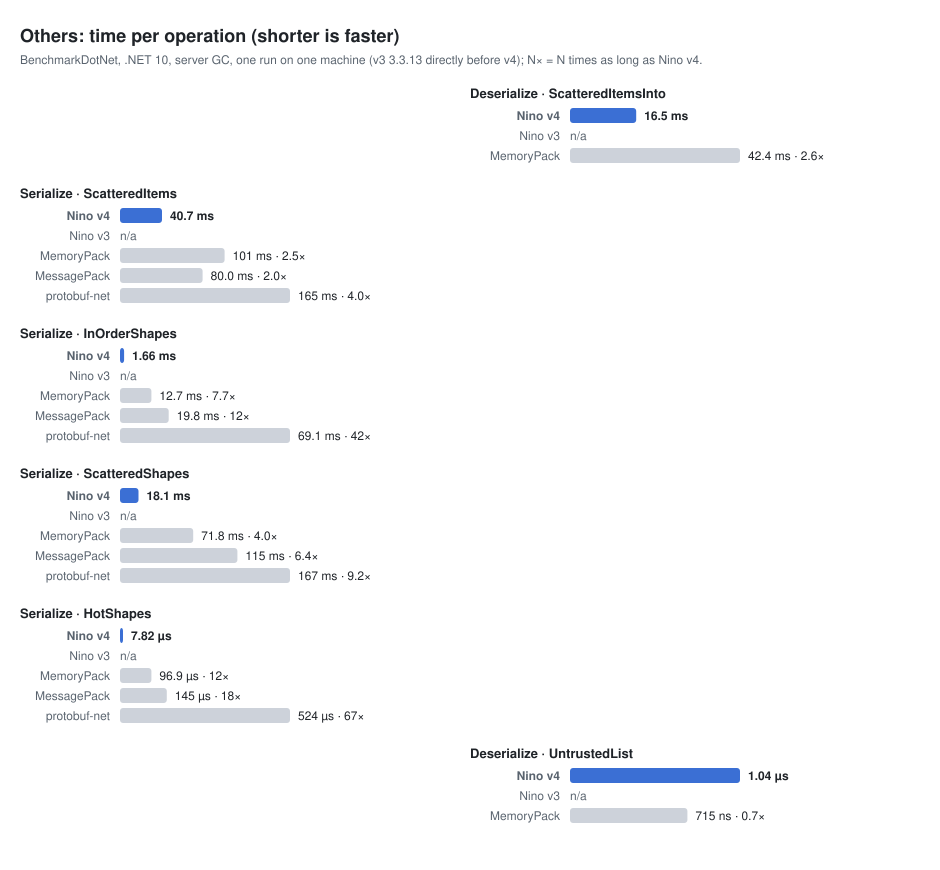

<div align="center">


# Nino

**C# 最快的二进制序列化库。**<br>
源生成、零分配、线程安全，可放心读取不可信数据。<br>
支持 .NET、Unity（Mono 和 IL2CPP）、Godot、Native AOT 和 HybridCLR，Go、Rust 和 TypeScript 也能读写，字节完全一致。

[](https://www.nuget.org/packages/Nino)
[](https://openupm.com/packages/com.jasonxudeveloper.nino/)
[](https://crates.io/crates/nino-serialization)<br>
[](https://www.npmjs.com/package/nino-serialization)
[](https://pkg.go.dev/github.com/JasonXuDeveloper/Nino/runtimes/go/v4)<br>
[](https://github.com/JasonXuDeveloper/Nino/actions)
[](https://github.com/JasonXuDeveloper/Nino/blob/main/LICENSE)
[](https://nino.xgamedev.net/zh)
[](https://deepwiki.com/JasonXuDeveloper/Nino)

[**官网**](https://nino.xgamedev.net/zh) ·
[**快速上手**](https://nino.xgamedev.net/zh/docs/v4/start) ·
[**v4 新特性**](https://nino.xgamedev.net/zh/docs/v4/whats-new) ·
[**性能**](https://nino.xgamedev.net/zh/docs/v4/benchmarks) ·
[**QQ 群**](https://qm.qq.com/q/Octgj3BS8g) ·
[**English**](https://github.com/JasonXuDeveloper/Nino/blob/main/README.md)

</div>

## 为什么选 Nino

- **最快。** 12 个真实业务场景下，序列化比 MemoryPack 快 **<!--bench:ser.range-->1.5–5.4<!--/bench--> 倍**，比 MessagePack 快 **<!--bench:msgpack.ser.range-->3.4–18<!--/bench--> 倍**，比 protobuf-net 快 **<!--bench:protobuf.ser.range-->6.4–73<!--/bench--> 倍**，比 Google.Protobuf 快 **<!--bench:gprotobuf.ser.range-->3.9–34<!--/bench--> 倍**，比 System.Text.Json 快 **<!--bench:json.ser.range-->4.3–136<!--/bench--> 倍**。[性能](#性能)
- **全平台 SIMD，Unity 里用 Burst。** 针对 AVX-512、AVX2、SSSE3、Arm64 和 WebAssembly 手写向量路径，搬运元组、带填充的结构体和字符串；Unity 里用 Burst 内核，Go、Rust 和 TypeScript 也有各自的向量内核，其他平台走可移植代码，写出的字节相同。[SIMD](https://nino.xgamedev.net/zh/docs/v4/simd)
- **可放心读取不可信数据。** 伪造的字节不会让进程崩溃，不会越界读取，不会分配与输入不成比例的内存，也无法指定要创建的类型；任何无效输入都只抛出 `NinoDataException`。[不可信数据](https://nino.xgamedev.net/zh/docs/v4/security)
- **热路径零分配。** 序列化到复用的 `IBufferWriter<byte>`，反序列化到已有对象或池化对象；线程安全，热路径上没有锁。[零分配](https://nino.xgamedev.net/zh/docs/v4/advanced/zero-allocation)
- **一切在编译期完成。** 生成的格式化器直接读写成员，不对成员做反射，没有 IL emit，也无需注册；IL2CPP、Native AOT 和 HybridCLR 热更都能直接用。[平台](https://nino.xgamedev.net/zh/docs/v4/platforms)
- **处处字节一致。** 不论哪种运行时、哪种 CPU，写出的字节都相同；Go、Rust 和 TypeScript 通过 `nino-gen` 生成的代码读写同样的数据，写出的字节也完全一致。[其他语言](https://nino.xgamedev.net/zh/docs/v4/advanced/codegen)
- **类型丰富，数据可演进。** 多态无需标签，支持版本容错和键控类型、引用追踪、序列化回调，以及全部 BCL 集合。[支持的类型](https://nino.xgamedev.net/zh/docs/v4/types)
- **写代码时就发现错误。** 44 条分析器诊断，许多带一键修复；有了[布局基线](https://nino.xgamedev.net/zh/docs/v4/evolving-data#layout-baseline)，存档或消息类型一旦改得让旧数据、旧版本读不了，马上就会标出来。[分析器](https://nino.xgamedev.net/zh/docs/v4/analyzers)

## 安装

| | 命令 | |
|---|---|---|
| .NET、Godot 4 | `dotnet add package Nino --prerelease` | .NET Standard 2.0 到 .NET 11、Native AOT；扩展包 `Nino.Immutable`、`Nino.AspNetCore`、`Nino.Codegen` |
| Unity 2022.3+ | `openupm add com.jasonxudeveloper.nino` | Mono、IL2CPP、HybridCLR · [指南](https://nino.xgamedev.net/zh/docs/v4/advanced/unity) |
| Go 1.22+ | `go get github.com/JasonXuDeveloper/Nino/runtimes/go/v4` | 生成的代码或 struct tag · [指南](https://nino.xgamedev.net/zh/docs/v4/advanced/go) |
| Rust 1.88+ | `cargo add nino-serialization` | 生成的代码或 `--features derive` · [指南](https://nino.xgamedev.net/zh/docs/v4/advanced/rust) |
| TypeScript | `npm install nino-serialization` | Node.js 和浏览器 · [指南](https://nino.xgamedev.net/zh/docs/v4/advanced/typescript) |

v4 还是预发行版，不加 `--prerelease` 时 NuGet 会装上 3.9.x，读不了 v4 的数据。`Nino.Codegen` 会在每次构建后把你的类型生成为
Go、Rust 或 TypeScript 代码（[指南](https://nino.xgamedev.net/zh/docs/v4/advanced/codegen)）。

## 快速开始

```csharp
using Nino.Core;

[NinoType]
public sealed class Order
{
    public long Id;
    public string Customer;
    public List<OrderLine> Lines;
}

byte[] bytes = NinoSerializer.Serialize(order);
Order copy = NinoDeserializer.Deserialize<Order>(bytes);
NinoDeserializer.Deserialize(bytes, ref copy); // 直接填充同一个实例
```

多态无需标签：以基类型声明的值，读回来仍是它的运行时类型。

```csharp
[NinoType] public abstract class Message { public int Seq; }
[NinoType] public sealed class Chat : Message { public string Text; }

byte[] bytes = NinoSerializer.Serialize<Message>(new Chat { Text = "hi" });
Message msg = NinoDeserializer.Deserialize<Message>(bytes); // 仍是 Chat
```

下一步：[第一个类型](https://nino.xgamedev.net/zh/docs/v4/start)、[数据演进](https://nino.xgamedev.net/zh/docs/v4/evolving-data)、[引用追踪](https://nino.xgamedev.net/zh/docs/v4/reference-tracking)、[对象池](https://nino.xgamedev.net/zh/docs/v4/pooling)和[高级用法](https://nino.xgamedev.net/zh/docs/v4/advanced)。

## AI 编程助手

```bash
npx skills add JasonXuDeveloper/Nino
```

装上 [`nino-serialization` skill](https://github.com/JasonXuDeveloper/Nino/blob/main/skills/nino-serialization/SKILL.md) 后，Claude Code、Codex、Cursor、Copilot 等助手会正确声明 `[NinoType]`、选对数据格式，并能修好每一条 NINO 诊断。文档另有给模型读的 [llms.txt](https://nino.xgamedev.net/llms.txt) 和 [llms-full.txt](https://nino.xgamedev.net/llms-full.txt)。

## 性能

| 12 个真实场景 | 序列化 | 反序列化 |
|---|---|---|
| 对比 MemoryPack | **快 <!--bench:ser.range-->1.5–5.4<!--/bench--> 倍** | **快 <!--bench:deser.range-->1.3–3.5<!--/bench--> 倍** |
| 对比 MessagePack | **快 <!--bench:msgpack.ser.range-->3.4–18<!--/bench--> 倍** | **快 <!--bench:msgpack.deser.range-->2.2–12<!--/bench--> 倍** |
| 对比 protobuf-net | **快 <!--bench:protobuf.ser.range-->6.4–73<!--/bench--> 倍** | **快 <!--bench:protobuf.deser.range-->3.8–35<!--/bench--> 倍** |
| 对比 Google.Protobuf | **快 <!--bench:gprotobuf.ser.range-->3.9–34<!--/bench--> 倍** | **快 <!--bench:gprotobuf.deser.range-->2.3–32<!--/bench--> 倍** |
| 对比 System.Text.Json | **快 <!--bench:json.ser.range-->4.3–136<!--/bench--> 倍** | **快 <!--bench:json.deser.range-->3.7–91<!--/bench--> 倍** |
| 反序列化到已有对象 | — | **0 B，比 MemoryPack 最多快 <!--bench:reuse.inplace-->7.6<!--/bench--> 倍** |

这 12 个场景：jvm-serializers 的 `MediaContent` 和一页 Stack Exchange API 数据（MessagePack、MemoryPack 自己的基准用的就是这套模型）；服务端的结果为接口的 RPC 调用、上个版本写进缓存的用户资料、两层事件继承外加泛型信封的事件流、一批日志；以及游戏真正会发的消息：读进客户端已有对象的状态同步快照、帧同步的输入帧、MMO 的 AOI 增量、共享对象的 SLG 地图区域和卡牌战斗回放，还有上个版本的放置游戏存档。每个库都用它最快的 API（Google.Protobuf 用自己生成的消息类型，System.Text.Json 用源生成器输出 UTF-8），缺的功能就用它常见的绕法（共享对象写成副本、读进已有对象改成新建）。区间只算 Nino 快出 5% 以上的场景，每个场景的耗时见文档。

<!--bench:charts-->
<details open>
<summary><b>真实场景</b></summary>

<picture>
  <source media="(prefers-color-scheme: dark)" srcset="https://raw.githubusercontent.com/JasonXuDeveloper/Nino/main/docs/assets/benchmark-workloads-dark.svg">
  <source media="(prefers-color-scheme: light)" srcset="https://raw.githubusercontent.com/JasonXuDeveloper/Nino/main/docs/assets/benchmark-workloads.svg">
  
</picture>

</details>

<details>
<summary><b>基础类型与结构体</b></summary>

<picture>
  <source media="(prefers-color-scheme: dark)" srcset="https://raw.githubusercontent.com/JasonXuDeveloper/Nino/main/docs/assets/benchmark-basic-dark.svg">
  <source media="(prefers-color-scheme: light)" srcset="https://raw.githubusercontent.com/JasonXuDeveloper/Nino/main/docs/assets/benchmark-basic.svg">
  
</picture>

</details>

<details>
<summary><b>多态</b></summary>

<picture>
  <source media="(prefers-color-scheme: dark)" srcset="https://raw.githubusercontent.com/JasonXuDeveloper/Nino/main/docs/assets/benchmark-polymorphism-dark.svg">
  <source media="(prefers-color-scheme: light)" srcset="https://raw.githubusercontent.com/JasonXuDeveloper/Nino/main/docs/assets/benchmark-polymorphism.svg">
  
</picture>

</details>

<details>
<summary><b>可空值</b></summary>

<picture>
  <source media="(prefers-color-scheme: dark)" srcset="https://raw.githubusercontent.com/JasonXuDeveloper/Nino/main/docs/assets/benchmark-nullable-dark.svg">
  <source media="(prefers-color-scheme: light)" srcset="https://raw.githubusercontent.com/JasonXuDeveloper/Nino/main/docs/assets/benchmark-nullable.svg">
  
</picture>

</details>

<details>
<summary><b>集合与常用类型</b></summary>

<picture>
  <source media="(prefers-color-scheme: dark)" srcset="https://raw.githubusercontent.com/JasonXuDeveloper/Nino/main/docs/assets/benchmark-collections-dark.svg">
  <source media="(prefers-color-scheme: light)" srcset="https://raw.githubusercontent.com/JasonXuDeveloper/Nino/main/docs/assets/benchmark-collections.svg">
  
</picture>

</details>

<details>
<summary><b>复用与对象池</b></summary>

<picture>
  <source media="(prefers-color-scheme: dark)" srcset="https://raw.githubusercontent.com/JasonXuDeveloper/Nino/main/docs/assets/benchmark-reuse-dark.svg">
  <source media="(prefers-color-scheme: light)" srcset="https://raw.githubusercontent.com/JasonXuDeveloper/Nino/main/docs/assets/benchmark-reuse.svg">
  
</picture>

</details>

<details>
<summary><b>引用跟踪与版本容错</b></summary>

<picture>
  <source media="(prefers-color-scheme: dark)" srcset="https://raw.githubusercontent.com/JasonXuDeveloper/Nino/main/docs/assets/benchmark-tracking-dark.svg">
  <source media="(prefers-color-scheme: light)" srcset="https://raw.githubusercontent.com/JasonXuDeveloper/Nino/main/docs/assets/benchmark-tracking.svg">
  
</picture>

</details>

<details>
<summary><b>其他</b></summary>

<picture>
  <source media="(prefers-color-scheme: dark)" srcset="https://raw.githubusercontent.com/JasonXuDeveloper/Nino/main/docs/assets/benchmark-others-dark.svg">
  <source media="(prefers-color-scheme: light)" srcset="https://raw.githubusercontent.com/JasonXuDeveloper/Nino/main/docs/assets/benchmark-others.svg">
  
</picture>

</details>
<!--/bench-->

<sub>BenchmarkDotNet <!--bench:env.bdn-->0.15.8<!--/bench-->，<!--bench:env.runtime-->.NET 10.0.15<!--/bench-->，服务器 GC，<!--bench:env.cpu-->AMD EPYC 9V74 3.69 GHz<!--/bench-->，GitHub runner 实测；所有库在同一次运行中测得，NuGet 上的 Nino 3.3.13 在同一台机器上<!--bench:v3.when-->紧接其前跑一次<!--/bench-->。那页 Stack Exchange 数据的大小：Nino <!--bench:payload.v4-->123,333<!--/bench--> 字节，MemoryPack <!--bench:payload.memorypack-->134,223<!--/bench--> 字节，MessagePack <!--bench:payload.msgpack-->115,778<!--/bench--> 字节，protobuf（两个库相同）<!--bench:payload.protobuf-->118,660<!--/bench--> 字节，JSON <!--bench:payload.json-->208,038<!--/bench--> 字节。测试方法与全部用例见 [docs/v4-benchmarks.md](https://github.com/JasonXuDeveloper/Nino/blob/main/docs/v4-benchmarks.md)。</sub>

更多：[全部 .NET 用例与 Arm64](https://nino.xgamedev.net/zh/docs/v4/benchmarks)、[Unity 与 Burst](https://nino.xgamedev.net/zh/docs/v4/benchmarks-unity)和 [Go、Rust 和 TypeScript](https://nino.xgamedev.net/zh/docs/v4/benchmarks-runtimes)。

## 适用场景

- **[服务与进程间通信](https://nino.xgamedev.net/zh/docs/v4/advanced/high-performance)**：每次调用零分配，可安全并发；[ASP.NET Core](https://nino.xgamedev.net/zh/docs/v4/advanced/aspnetcore) 以 `application/x-nino` 读写请求体与响应。
- **[RPC 与网络层](https://nino.xgamedev.net/zh/docs/v4/advanced/networking)**：直接写进 `PipeWriter`，也能直接从 `PipeReader` 的 `ReadOnlySequence<byte>` 读出，消息可池化复用；伪造的消息只会抛异常，不会让服务端崩溃。
- **[消息队列](https://nino.xgamedev.net/zh/docs/v4/advanced/message-queues)**、**[缓存](https://nino.xgamedev.net/zh/docs/v4/advanced/caching)**和**[存储](https://nino.xgamedev.net/zh/docs/v4/advanced/persistence)**：多态事件，数据小巧，字段可以跨版本增加、调序和删除。
- **[网页、Node、Go 与 Rust](https://nino.xgamedev.net/zh/docs/v4/advanced/codegen)**：每次构建后生成类型和编解码器，与 .NET 互相读写，字节一致。
- **[Unity](https://nino.xgamedev.net/zh/docs/v4/advanced/unity)**：Mono 和 IL2CPP，HybridCLR 无需初始化，Burst SIMD 内核，内置 `AnimationCurve` 和 `Gradient`。
- **[Godot 4（.NET）](https://nino.xgamedev.net/zh/docs/v4/advanced/godot)**：直接引用 NuGet 包；`Vector3`、`Transform3D` 等数学结构体按原始内存拷贝。

## 与其他序列化库对比

| | Nino v4 | MemoryPack | MessagePack | protobuf | System.Text.Json |
|---|---|---|---|---|---|
| 格式 | 二进制，值不带标签 | 二进制，内存布局 | MessagePack，自描述 | Protocol Buffers，字段编号 | JSON 文本 |
| 不可信输入 | **默认安全**，只有一种异常 | "仅用于可信数据" | 需开启 `UntrustedData` | 深度上限 | 深度上限 |
| 多态 | **自动**，任何基类或接口 | `[MemoryPackUnion]` 标签 | `[Union]` 键 | `[ProtoInclude]` 编号、`oneof` | 每个子类一个 `[JsonDerivedType]` |
| 共享与循环引用 | `trackReferences` | 循环引用 | 不支持 | 不支持 | `ReferenceHandler.Preserve` |
| 反序列化到已有对象 | **原地复用，0 B** | 清空集合，重建元素 | 不支持 | 合并，不能覆盖 | 仅成员（`Populate`） |
| 其他语言 | Go、Rust、TypeScript，从 C# 类型生成 | TypeScript | 任何 MessagePack 库 | 任何 protobuf 库 | 任何语言 |

protobuf 一列指 protobuf-net 和 Google.Protobuf。怎么选、Nino 有哪些局限，见[序列化库选型](https://nino.xgamedev.net/zh/docs/v4/compare)。详细对比：[MemoryPack](https://nino.xgamedev.net/zh/docs/v4/vs-memorypack)、
[MessagePack](https://nino.xgamedev.net/zh/docs/v4/vs-messagepack)、[protobuf-net](https://nino.xgamedev.net/zh/docs/v4/vs-protobuf-net)。

## v4 对比 v3

v4 重写了运行时和生成器；**二进制格式与 v3 不兼容。**

| v4 对比 v3（3.3.13） | |
|---|---|
| 序列化 | <!--bench:v3.ser-->类**快 1.9 倍**，类数组**快 2.4 倍**，结构体持平，结构体数组**快 1.2 倍**<!--/bench--> |
| 反序列化 | <!--bench:v3.deser-->类**快 1.5 倍**，类数组**快 1.5 倍**，结构体持平，结构体数组持平<!--/bench--> |
| 构建 | <!--bench:v3.build-->1,100 个类型时生成代码的编译**快 188 倍**（193 秒 → 1.03 秒）；源码**小 12 倍**<!--/bench--> |

[v4 新特性](https://nino.xgamedev.net/zh/docs/v4/whats-new) · [更新日志](https://nino.xgamedev.net/zh/docs/v4/changelog) · [迁移指南](https://nino.xgamedev.net/zh/docs/v4/migration)

## 参与贡献

欢迎提交 Issue 和 Pull Request，详见 [CONTRIBUTING.md](https://github.com/JasonXuDeveloper/Nino/blob/main/.github/CONTRIBUTING.md)；安全问题请按 [SECURITY.md](https://github.com/JasonXuDeveloper/Nino/blob/main/.github/SECURITY.md) 私下报告。使用问题和交流讨论欢迎加 QQ 群 [1054653934](https://qm.qq.com/q/Octgj3BS8g)。

## 许可证

[MIT](https://github.com/JasonXuDeveloper/Nino/blob/main/LICENSE) © [JasonXuDeveloper](https://github.com/JasonXuDeveloper)
