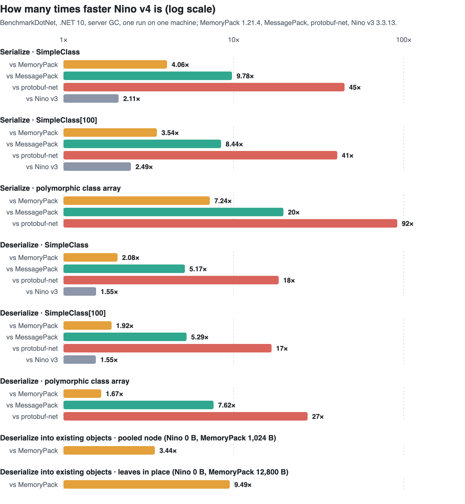
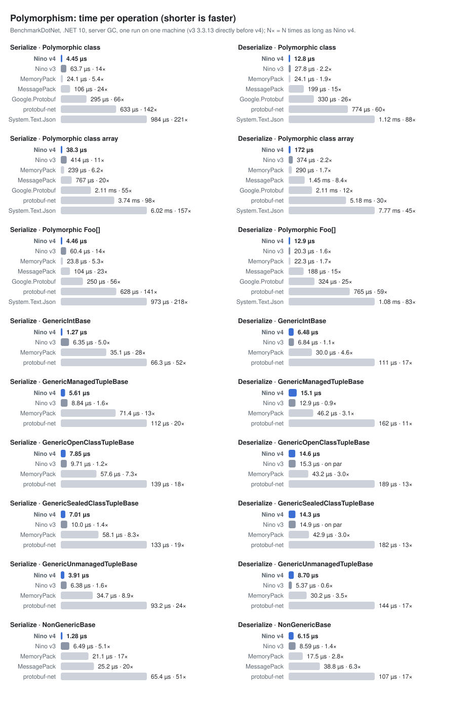
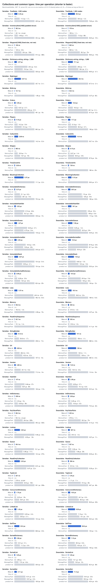
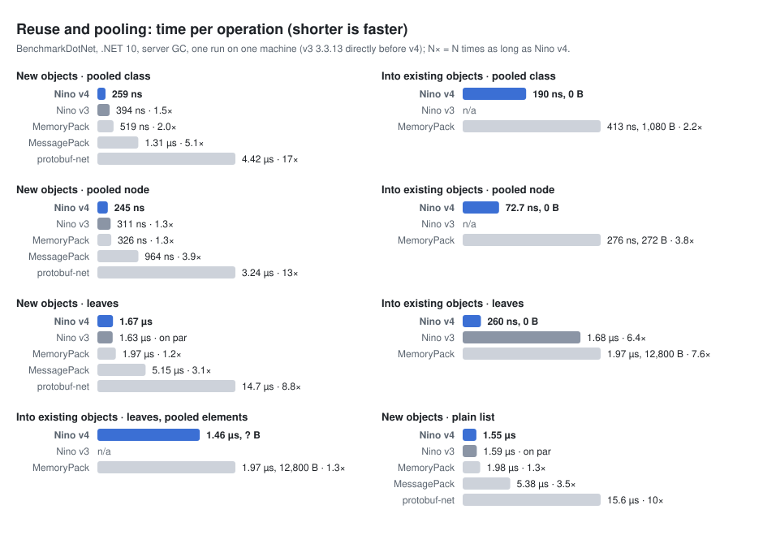
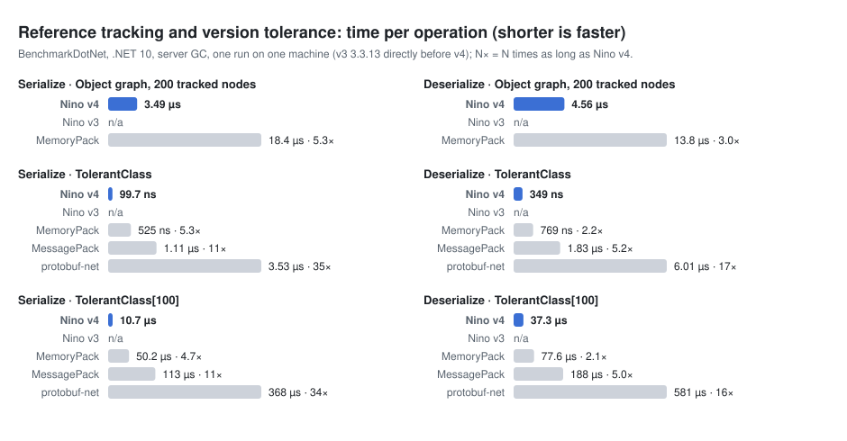

# Nino v4 benchmarks

Why v4: what it costs to build a project that uses Nino, and how fast serialization runs, compared with
v3 (3.3.13, the last release of the v3 API) and with [MemoryPack](https://github.com/Cysharp/MemoryPack) 1.22.0.

Every table here is the newest release's: its CI run (`report.yml`) benchmarks v4 against MemoryPack, each case's
Nino and MemoryPack runs on one runner (v3 3.3.13 on the `SimpleTest`, `PolymorphicTest`, nullable, workload and `PooledGraphTest` runners), and v3 3.3.13's source generator
against the release's on one more runner, puts the reports in the release notes, and writes these tables from them
(`benchmarks/reports/readme.py`), as it does for the README and the documentation site. Generated code sizes do not
depend on the machine; absolute times vary between machines, and the ratios are what to look at.

## Build time and generated code

Workload: a synthetic assembly of `N` abstract root classes, each with a chain of 8 derived classes, a sealed
leaf and a struct (`N × 11` types). Members are primitives, strings, `List<T>`, `Dictionary<int, string>`,
references to other `[NinoType]`s and private fields. The harness (`benchmarks/Nino.GeneratorBenchmark`, Roslyn
in process) runs the generator on the compilation, then emits the whole assembly; it also measures re-running the
generator after an edit. v3's generator and runtime are Nino 3.3.13 from nuget.org, v4's the release's; the two run
one after the other on one runner, and each time is the median of the runs after the warm-up runs (at least one,
and at least 60 s of them; the release notes' "Build: v3 3.3.13 vs v4" section names how many measured). Sizes are
millions of chars (source) and bytes (IL).
These tables come from <!--bench:doc.build.source-->a local run on an Intel Xeon 2.10 GHz (4 cores, AVX-512, .NET SDK 10.0.402)<!--/bench-->.

### 330 types (N = 30)

The generator rows are short (tenths of a second) and move between runs, so read them as "several times faster"
rather than as exact ratios.

<!--bench:doc.build.30-->
| | v3 (3.3.13) | v4 | v4 vs v3 |
|---|---:|---:|---:|
| Generated source | 18.7 MB (363,233 lines) | 1.31 MB (23,215 lines) | **14× smaller** |
| Compiling the generated code (emit) | 42.9 s | 0.84 s | **51× faster** |
| Running the generator | 1.01 s | 0.32 s | **3.1× faster** |
| Re-generating after editing a member | 1.03 s | 0.12 s | **8.3× faster** |
| Re-generating after editing a comment | 1.01 s | 0.13 s | **7.8× faster** |
| IL of the generated code | 2.21 MB | 0.42 MB | **5.3× smaller** |
<!--/bench-->

### 1,100 types (N = 100)

<!--bench:doc.build.100-->
| | v3 (3.3.13) | v4 | v4 vs v3 |
|---|---:|---:|---:|
| Generated source | 62.0 MB (1,204,143 lines) | 4.38 MB (77,535 lines) | **14× smaller** |
| Compiling the generated code (emit) | 462 s | 2.1 s | **221× faster** |
| Running the generator | 4.6 s | 0.42 s | **11× faster** |
| Re-generating after editing a member | 3.5 s | 0.48 s | **7.4× faster** |
| Re-generating after editing a comment | 4.0 s | 0.44 s | **9.1× faster** |
| IL of the generated code | 7.3 MB | 1.50 MB | **4.9× smaller** |
<!--/bench-->

v3's compile time grows much faster than the number of types (compare the emit rows: 3.3× the types); v4's grows
about linearly.

## Runtime

`benchmarks/Nino.Benchmark` (`ShortRun` job with 5 warm-up and 15 measured iterations, each case in 3 processes, server
GC), every benchmark class, v4 and MemoryPack 1.22.0 side by side, with MessagePack 3.1.12 and protobuf-net
3.4.40 wherever they can write the same data, and in `SimpleTest`, `PolymorphicTest`, `NullableTest`, `CollectionsTest`'s nullable
collections and `WorkloadTest` Google.Protobuf 3.36.2 and System.Text.Json (.NET 10): the release run spreads the classes over twelve runners per architecture
and keeps every serializer's run of a case on one. v3 is Nino 3.3.13 from nuget.org, running a port of
the same `SimpleTest`, `PolymorphicTest`, `NullableTest` and nullable collections (same data, same attributes), each on
the runner of the same v4 cases directly before them; it has no pooling, reference, version-tolerant or fixed-size
benchmarks.
These tables come from <!--bench:doc.source-->a local `benchmarks/run.sh` run: BenchmarkDotNet 0.15.8, .NET 10.0.14, Intel Xeon 6973P-C 3.54 GHz; v3 3.3.13 from NuGet ran directly before v4 on the same machine<!--/bench-->.

Differences under 5% are reported as on par: MemoryPack runs in both sessions, and its two times show how much the
runner moved. A time under 1 ns (about three clock cycles) cannot be told apart from another: reading a 40-byte struct
measures anywhere from 0.05 to 0.8 ns in both libraries, once BenchmarkDotNet subtracts its empty-method overhead.
v4 under 1 ns against a measurable time is faster, too fast to measure, with no ratio; both under it is on par. A dash
in a "vs" column means the case was not measured there, or v4 is not ahead.

Each library serializes to its own buffer writer: Nino to `NinoArrayBufferWriter`, MemoryPack and MessagePack to
`ArrayBufferWriter<byte>`, protobuf-net to a `MemoryStream` (its fastest writer), Google.Protobuf to
`ArrayBufferWriter<byte>` (its own messages, generated from the schema protobuf-net's contracts produce: the same
messages, subtypes as a `oneof` per level) and System.Text.Json UTF-8 through its source generator into a reused
`Utf8JsonWriter`. Into any other `IBufferWriter<byte>` Nino writes raw and fixed-size values in place too, and
everything else into a pooled buffer that it then copies over, one copy more than these tables measure.
Before the benchmarks run, `--verify` (`benchmarks/Nino.Benchmark/Harness/Verify.cs`) checks every case: each serialize case writes
its payload's bytes, and every deserialize case of a category reads back the same value, deep-compared. The data is
seeded, so every run serializes the same values.

### Charts

One chart per group of cases, each library's time per operation (shorter is faster) with its multiple of Nino v4's,
v3 3.3.13 n/a where it has no port of the case; every number is in the tables below.

<!--bench:doc.charts-->
<details open>
<summary><b>Basic types and structs</b></summary>

<picture>
  <source media="(prefers-color-scheme: dark)" srcset="https://raw.githubusercontent.com/JasonXuDeveloper/Nino/main/docs/assets/benchmark-basic-dark.svg">
  <source media="(prefers-color-scheme: light)" srcset="https://raw.githubusercontent.com/JasonXuDeveloper/Nino/main/docs/assets/benchmark-basic.svg">
  
</picture>

</details>

<details open>
<summary><b>Polymorphism</b></summary>

<picture>
  <source media="(prefers-color-scheme: dark)" srcset="https://raw.githubusercontent.com/JasonXuDeveloper/Nino/main/docs/assets/benchmark-polymorphism-dark.svg">
  <source media="(prefers-color-scheme: light)" srcset="https://raw.githubusercontent.com/JasonXuDeveloper/Nino/main/docs/assets/benchmark-polymorphism.svg">
  
</picture>

</details>

<details open>
<summary><b>Collections and common types</b></summary>

<picture>
  <source media="(prefers-color-scheme: dark)" srcset="https://raw.githubusercontent.com/JasonXuDeveloper/Nino/main/docs/assets/benchmark-collections-dark.svg">
  <source media="(prefers-color-scheme: light)" srcset="https://raw.githubusercontent.com/JasonXuDeveloper/Nino/main/docs/assets/benchmark-collections.svg">
  
</picture>

</details>

<details open>
<summary><b>Reuse and pooling</b></summary>

<picture>
  <source media="(prefers-color-scheme: dark)" srcset="https://raw.githubusercontent.com/JasonXuDeveloper/Nino/main/docs/assets/benchmark-reuse-dark.svg">
  <source media="(prefers-color-scheme: light)" srcset="https://raw.githubusercontent.com/JasonXuDeveloper/Nino/main/docs/assets/benchmark-reuse.svg">
  
</picture>

</details>

<details open>
<summary><b>Reference tracking and version tolerance</b></summary>

<picture>
  <source media="(prefers-color-scheme: dark)" srcset="https://raw.githubusercontent.com/JasonXuDeveloper/Nino/main/docs/assets/benchmark-tracking-dark.svg">
  <source media="(prefers-color-scheme: light)" srcset="https://raw.githubusercontent.com/JasonXuDeveloper/Nino/main/docs/assets/benchmark-tracking.svg">
  
</picture>

</details>

<details open>
<summary><b>Others</b></summary>

<picture>
  <source media="(prefers-color-scheme: dark)" srcset="https://raw.githubusercontent.com/JasonXuDeveloper/Nino/main/docs/assets/benchmark-others-dark.svg">
  <source media="(prefers-color-scheme: light)" srcset="https://raw.githubusercontent.com/JasonXuDeveloper/Nino/main/docs/assets/benchmark-others.svg">
  
</picture>

</details>
<!--/bench-->

### Real-world workloads

`WorkloadTest` (`benchmarks/Nino.Benchmark/Workloads`), 12 payloads with the problems real ones have:

| Workload | What it is | What it exercises |
|---|---|---|
| `MediaContent` | jvm-serializers' standard payload, with its standard values | small objects, enums, a string list |
| `StackOverflowPage` | 20 Stack Exchange API questions with answers, comments and users (the models of Jil's, MessagePack-CSharp's and MemoryPack's benchmarks) | nested lists, nullable dates, HTML bodies |
| `RpcCall` | a request and its response, the result an interface (`Ok<List<Item>>`, `NotFound`, `ValidationFailed`) | interface polymorphism, a generic subtype, `decimal`, `Guid` |
| `ProfileCache` | a profile the previous release cached, read by this one (a member removed, two added) | version tolerance: Nino's keyed format, MemoryPack's version-tolerant one |
| `EventStream` | 500 events of an event store: two levels of abstract classes (three families, eight events) in generic envelopes | deep hierarchies, generic subtypes of a non-generic base |
| `LogBatch` | 1,000 structured log events | strings, small dictionaries |
| `StateSnapshot` | a state-sync server's tick: 64 entities whose components are an interface, full or changed only, read into the client's snapshot | interface lists, deserializing into an existing object |
| `LockstepFrames` | a frame-sync broadcast: 10 frames of 8 players' input commands (an interface) | many tiny polymorphic messages |
| `AoiUpdate` | an MMO's area-of-interest update: 200 enter, leave, move, cast and buff events, and chat | an abstract base with five subtypes, structs |
| `WorldRegion` | an SLG map region: 64 x 64 tiles, cities, armies and marches, sharing their alliances | a large struct array, shared references |
| `CardBattleLog` | a card battle's replay: 300 actions in two levels of abstract classes, sharing the card definitions | deep hierarchies, shared references |
| `IdleSave` | an idle game's save from the previous release (members appended since), read into the save the game holds | big numbers, dictionaries, version tolerance, deserializing into an existing object |

Every library writes the same values through its fastest API: Google.Protobuf its own messages, generated from
`workloads.proto`, which protobuf-net's contracts of the same models produce (so both write the same messages: one
payload size), System.Text.Json UTF-8 through its source generator into a reused `Utf8JsonWriter`. Where a library
lacks a feature it takes its usual workaround: MessagePack and protobuf write a copy of a shared object for each
reference (System.Text.Json uses its `Preserve` references), and the libraries that cannot read into an existing
object (all but Nino and MemoryPack's overwrite) read a new one. These are the README's headline numbers. A ratio
in parentheses is how many times faster Nino is; a dash, that it is not ahead by more than 5%.

Serialize (to a reused buffer):

<!--bench:doc.table.workloads.serialize-->
<!--/bench-->

Deserialize (new instances):

<!--bench:doc.table.workloads.deserialize-->
<!--/bench-->

Payload (bytes):

<!--bench:doc.table.workloads.payload-->
<!--/bench-->

### Serialize (to a reused buffer writer)

<!--bench:doc.table.serialize-->
| Case | v4 | MemoryPack | MessagePack | protobuf-net | v3 | v4 vs MemoryPack | v4 vs v3 |
|---|---:|---:|---:|---:|---:|---:|---:|
| `SimpleClass` | 56.8 ns | 231 ns | 555 ns | 2.55 µs | 120 ns | **4.06× faster** | **2.11× faster** |
| `SimpleClass[100]` | 6.58 µs | 23.3 µs | 55.5 µs | 268 µs | 16.4 µs | **3.54× faster** | **2.49× faster** |
| Polymorphic class | 3.30 µs | 16.1 µs | 75.0 µs | 403 µs | — | **4.88× faster** | — |
| Polymorphic class array | 27.0 µs | 196 µs | 530 µs | 2.47 ms | — | **7.24× faster** | — |
| Polymorphic `Foo[]` | 3.74 µs | 15.8 µs | 76.0 µs | 395 µs | — | **4.21× faster** | — |
| `SimpleStruct` (`int` + `DateTime`) | 1.16 ns | 2.87 ns | 35.0 ns | 92.5 ns | 1.59 ns | **2.48× faster** | **1.37× faster** |
| `SimpleStruct[100]` | 11.5 ns | 13.5 ns | 2.13 µs | 7.02 µs | 12.0 ns | **1.18× faster** | on par |
| `Vector4[10000]` | 3.38 µs | 3.31 µs | 90.9 µs | 413 µs | 3.35 µs | on par | on par |
<!--/bench-->

`SimpleStruct` is declared with `[StructLayout(LayoutKind.Sequential, Pack = 4)]`: 12 bytes, no padding, so every
serializer copies it as one block. Without `Pack`, it is 16 bytes with 4 bytes of padding after the `int`. v4 zeroes
padding, so the output is deterministic and never carries leftover memory (an `ArrayPool` array or `stackalloc`
under `[SkipLocalsInit]` can hold anything there); v3 and MemoryPack copy whatever the padding contains. In an
earlier run with the padded struct, that masked copy made `SimpleStruct[100]` serialize take 25.9 ns against
21.4 ns for MemoryPack and 20.9 ns for v3. A single value's padding is cleared by one or two inlined constant stores.

### Deserialize (new instances)

<!--bench:doc.table.deserialize-->
| Case | v4 | MemoryPack | MessagePack | protobuf-net | v3 | v4 vs MemoryPack | v4 vs v3 |
|---|---:|---:|---:|---:|---:|---:|---:|
| `SimpleClass` | 340 ns | 706 ns | 1.76 µs | 6.26 µs | 528 ns | **2.08× faster** | **1.55× faster** |
| `SimpleClass[100]` | 36.0 µs | 69.1 µs | 191 µs | 602 µs | 55.8 µs | **1.92× faster** | **1.55× faster** |
| Polymorphic class | 9.16 µs | 16.5 µs | 118 µs | 483 µs | — | **1.80× faster** | — |
| Polymorphic class array | 117 µs | 195 µs | 891 µs | 3.18 ms | — | **1.67× faster** | — |
| Polymorphic `Foo[]` | 8.52 µs | 15.4 µs | 118 µs | 487 µs | — | **1.81× faster** | — |
| `SimpleStruct` (`int` + `DateTime`) | < 1 ns | 1.40 ns | 77.2 ns | 231 ns | < 1 ns | **faster** (too fast to measure) | on par |
| `SimpleStruct[100]` | 81.7 ns | 96.5 ns | 3.41 µs | 10.1 µs | 81.9 ns | **1.18× faster** | on par |
| `Vector4[10000]` | 120 µs | 119 µs | 373 µs | 719 µs | 118 µs | on par | on par |
<!--/bench-->


Deserializing classes is dominated by allocating the result objects, the same bytes for all three. To see how
much is left, an A/B harness built the same `SimpleClass` graph by hand (`new SimpleClass`, strings copied from
spans, the same arrays, list and dictionaries): in an earlier run that floor took 518–636 ns and v4 602–662 ns,
mostly the cost of decoding the UTF-8 member. v4 stays within reach of that floor while adding reference
tracking, reuse deserialization with pool recycling, version tolerance and payload validation, and it is ahead of
MemoryPack and v3. `Vector4[10000]` allocates a 160 KB array on the large object heap per call, so that row
mostly measures gen-2 collections.

### Deserialize into existing instances (pooling)

Nino can deserialize into an existing object graph (reuse deserialization) and take new instances from
`[NinoPooled]` pools; MemoryPack overwrites existing instances.

<!--bench:doc.table.reuse-->
| Case | Nino new | Nino reusing | MemoryPack new | MemoryPack overwrite | Nino reusing vs overwrite |
|---|---:|---:|---:|---:|---:|
| Pooled node | 282 ns | **75.3 ns** (0 B) | 316 ns | 259 ns (1,024 B) | **3.44× faster** |
| Pooled leaves, in place | 1.76 µs | **273 ns** (0 B) | 2.16 µs | 2.59 µs (12,800 B) | **9.49× faster** |
| Pooled leaves, pooled elements | 1.76 µs | **1.46 µs** (0 B) | 2.16 µs | 2.59 µs (12,800 B) | **1.78× faster** |
| Pooled class | 287 ns | **145 ns** (0 B) | 486 ns | 405 ns (1,080 B) | **2.79× faster** |
<!--/bench-->

The "new" columns allocate the same bytes in both serializers. Reusing is where v4 pulls away: in-place reuse
allocates nothing, pooled nodes come back without allocating, and strings whose text did not change are kept
(the pooled class's strings were its 1,080 bytes per call before).

### Reference tracking, version tolerance, fixed-size types and common data

Each against the closest MemoryPack mode: `ReferenceTest` (a graph of 200 nodes with shared objects and cycles;
`trackReferences: true` against `GenerateType.CircularReference`), `VersionTolerantTest` (`SimpleClass`'s members;
`NinoFormat.VersionTolerant`, one length per object, against `GenerateType.VersionTolerant`, a length per member)
and `FixedSizeTest` (a 40-byte struct, the same members in a sealed class and 100 of the classes, through the
`byte[]` APIs of both, so allocating the result is part of every call). `CommonTypesTest` adds common type shapes
(`benchmarks/Nino.Benchmark/Fixtures/CommonTypes.cs`): a tree; a padded struct array; an array of structs of fixed size that are not raw (a value tuple member), which
are read and written as blocks; and a string dictionary. `CollectionsTest` covers collections of the base
class library: a list of tuples, an array of key-value pairs, and hashed, queued, linked, sorted and concurrent
collections. `BclTypesTest` covers the other base class library types both libraries have formatters for: `BigInteger`,
`Uri`, `Version`, `StringBuilder`, `BitArray`, `CultureInfo`, `TimeZoneInfo`, `Lazy<T>`, memory and sequences, read-only,
lookup and blocking collections, and the immutable collections. Its `TimeZoneInfo` case measures a design difference
more than speed: Nino writes a system time zone by its id and reads it back from the system's cached zones, while
MemoryPack writes and parses the zone's whole serialized string on every call.

<!--bench:doc.table.extra-->
| Case | Serialize v4 | MemoryPack | v4 vs MemoryPack | Deserialize v4 | MemoryPack | v4 vs MemoryPack |
|---|---:|---:|---:|---:|---:|---:|
| Object graph, 200 tracked nodes | 3.49 µs | 18.4 µs | **5.29× faster** | 4.56 µs | 13.8 µs | **3.02× faster** |
| `TolerantClass` | 99.7 ns | 525 ns | **5.27× faster** | 349 ns | 769 ns | **2.21× faster** |
| `TolerantClass[100]` | 10.7 µs | 50.2 µs | **4.68× faster** | 37.3 µs | 77.6 µs | **2.08× faster** |
| `FixedStruct` | 5.08 ns | 5.02 ns | on par | < 1 ns | < 1 ns | on par |
| `FixedClass` | 4.86 ns | 12.7 ns | **2.62× faster** | 4.83 ns | 10.6 ns | **2.20× faster** |
| `FixedClass[100]` | 281 ns | 996 ns | **3.54× faster** | 692 ns | 994 ns | **1.44× faster** |
| `TreeNode`, 1,365 nodes | 6.32 µs | 11.0 µs | **1.74× faster** | 26.5 µs | 33.0 µs | **1.25× faster** |
| `InventoryItem[1000]` (padded struct) | 38.3 ns | 40.1 ns | on par | 178 ns | 199 ns | **1.11× faster** |
| `Waypoint[1000]` (fixed size, not raw) | 150 ns | 134 ns | — | 502 ns | 593 ns | **1.18× faster** |
| `Dictionary<string, string>`, 1,000 | 4.47 µs | 23.4 µs | **5.23× faster** | 17.1 µs | 29.8 µs | **1.75× faster** |
<!--/bench-->

Deserializing `FixedStruct` is one 40-byte copy, about a clock cycle in both. Serializing it is an allocation
and one 40-byte copy from the value straight into the array, the same machine code in both. Up to 4.0.0-rc.2,
`NinoSerializer.Serialize(T)` took the value by value, so a value read from a field (as in this benchmark) was
first copied to the stack, before the allocation; since 4.0.0-rc.3 it takes `in T`, as MemoryPack does.

`InventoryItem` holds one byte of padding per element (an `int`, a `short` and a `bool` in 8 bytes). v4 writes it as
zero, a masked copy where MemoryPack makes a plain one, which is the extra work in v4's time for that row.
MemoryPack's output carries whatever the memory held there: two `InventoryItem[2]` of equal values, one built in a
buffer that had held `0xCD` bytes, serialize to different bytes in MemoryPack 1.22.0 (`CD` in each padding byte)
and to the same bytes in v4. Likewise `List<(int, long)>` in `CollectionsTest` is 12 bytes per item in v4 and 16 in
MemoryPack, which copies the tuple's memory, padding included; that memory is 12 bytes on Windows x86 .NET (see
`docs/pitfalls.md`), and on Mono the items are in another order.

Neither serializer allocates on the serialize paths above (0 B per call), and deserialization allocates only
the result objects.

## Runtime optimizations

* **Struct formatters, inlined end to end.** Built-in and generated formatters are structs, and element
  formatters are type parameters (`ListFormatter<TList, T, TFormatter>`), so the JIT/AOT compiler inlines
  element serialization into the collection loop. Members call `default(TFormatter).Serialize(...)`: a
  direct call, no virtual dispatch.
* **Blocks instead of fields.** Consecutive unmanaged members are reserved and written as one block (one
  bounds check), unmanaged arrays, lists and raw `[NinoType]` structs are single block copies, and arrays and
  lists of fixed-size elements are written straight into a `byte[]` of their exact size, without a scratch buffer.
  A raw nullable reads its presence byte and its value under one bounds check, and multi-dimensional arrays take
  the block paths of flat ones.
* **Copies sized to the CPU.** Up to 64 bytes (on 64-bit runtimes) or 128 bytes (with 32-byte vectors) are copied
  inline, as overlapping loads and stores of the widest vector that fits (up to 64 bytes the same way in one call on
  32-bit x86, WebAssembly and .NET on Arm32, where unaligned 8-byte accesses cannot fault); up to 32 KB (64-byte
  vectors) or 16 KB (32-byte vectors, from 256 bytes) as vectors with aligned stores; on Arm64 up to 64 KB as pairs of
  16-byte loads and stores (`ldp`/`stp`), 64 bytes a step from an aligned source address, which beats the C library's
  `memcpy` there (with only 16-byte vectors on x64 with SSE and WebAssembly, `memmove` from 65 bytes); beyond, with
  `memmove`, which is several times slower than the vector loop at these sizes on some CPUs (GitHub's EPYC 7763
  runners). Reads of 6 KB or more into a new array use `memmove`, whose `rep movsb` writes fresh cache lines without
  reading them first, except on AMD CPUs, where it is slower than vector stores there too (1,000
  `KeyValuePair<int, int>` read in 418 ns instead of 465 ns on GitHub's EPYC 7763 runners); a list of up to 64 bytes
  read in place calls `memmove` directly, cheaper than the out-of-line copy for so few bytes.
* **Zeroing only where it pays.** A new array that a read fills whole, as one block copy or as blocks (padded tuples
  and block structs, their padding written as zero), is allocated uninitialized from 6 KB: below, the runtime's
  uninitialized allocation costs more than zeroing on GitHub's x64 and Arm64 runners. One filled value by value
  (`DateTimeOffset`s, values Untrusted mode checks a field at a time) is allocated zeroed. Slots a read overwrites
  are not cleared first, in new or existing lists and arrays.
* **Padded tuples as vector shuffles.** Arrays and lists of value tuples, `KeyValuePair`s and other padded values are
  written and read a group of values at a time: with AVX-512, by permutes across a vector; elsewhere, each 16-byte
  lane is shuffled from at most two 16-byte windows (`vpshufb` on AVX2 and SSSE3, `TBL` on Arm64, swizzle on
  WebAssembly), with the cheaper of an unaligned and a grid-aligned plan for each type. Without AVX-512 VBMI (and not on Arm64), a
  value whose exact group would take more than four vectors (5-byte blocks such as `(byte, int)`: 32 values in five
  32-byte vectors) moves in groups of as many values as one to four vectors hold (six `(byte, int)` a 32-byte vector,
  twelve in four 16-byte ones), the rest of the last vector rewritten by the next group, instead of one value at a
  time. The check of whether two windows share a 32-byte load is inlined: left a call in the AVX2 group loop, it
  spilled the vectors around each load, and AVX2 writes took twice as long as SSSE3's. On Arm64, a plan whose windows
  lie on the 16-byte grid loads each window of a group once, before any lookup, so the JIT gives them consecutive
  registers and every `TBL` takes one window or two consecutive ones as they are: four `(int, long)` are written from
  two `ldp` by three lookups and read from three loads by four, with no register copies (loaded for each lookup, the
  loads two lookups share took a copy each). Each loop step moves a whole group and advances two cursors, without an
  index multiply. Values of 8 bytes or less (`(byte, int)`, `(short, int)`) move eight at a time as one 64-byte
  permute (`vpermb` with AVX-512 VBMI); on Arm64 each 16 bytes written is one `TBL` over just the 16-byte quarters its
  bytes come from (one to four consecutive registers, each a micro-op on Neoverse cores), only those quarters are
  loaded and only the group's bytes stored, and the permute's indices stay in registers (a `Vector512` is a struct of
  four there, which as a parameter was copied through the stack every group). Where the stores are aligned, the
  unaligned head and tail of the output are covered by whole groups that overlap the body, so the time does not depend
  on where the buffer starts.
* **Layout flags folded by the JIT.** Whether a type's memory layout equals the wire layout, and whether it
  has padding, are `static readonly` values, which tiered compilation turns into constants: on 64-bit
  runtimes a raw struct costs a plain copy. Other runtimes (32-bit, old Mono) convert field by field into
  the same bytes.
* **SIMD masked copy for padding.** Padding is zeroed so output is deterministic. Arrays of padded structs
  are copied through a `Vector<T>` mask (AND with a repeated byte mask) in the same pass as the copy: no
  second pass, which would reload freshly stored bytes and stall on store forwarding. Stores are aligned to
  the vector width (the block usually follows a 4-byte length, so unaligned stores would split cache lines
  every other store), the loop is unrolled 4×, and the unaligned head and tail vectors overlap the body.
  On 100 padded `SimpleStruct`s (16 bytes each without `Pack`, 1.6 KB) this costs about 5 ns over a plain `memcpy`.
  The loop indexes with native-sized offsets, and on Arm64 loads and stores pairs of 16-byte vectors (`ldp`/`stp`), as the C library's `memcpy`
  does. A struct without padding, or one
  declared with `[StructLayout(LayoutKind.Sequential, Pack = 4)]`, skips the mask and is a plain block copy;
  `LayoutKind.Auto` structs are not raw at all and are written field by field.
* **Store-only padding for single values.** A single padded value is written, then its padding runs are
  zeroed with plain stores, never read back. The first two runs are `static readonly` offsets and lengths, so
  the JIT emits them as one or two constant stores, inlined.
* **Collection loops specialized on element types.** Pair loops of `Dictionary<TKey, TValue>` live in a helper
  generic over the key and value types only (the dictionary type itself would be a reference-type parameter,
  making the whole loop shared generic code); exact `Dictionary<,>` members get a formatter without the
  dictionary type parameter, which also shortens generated code. Raw `HashSet<T>` and `Dictionary<TKey, TValue>` are written from their
  entries array when none has been removed (the layouts of .NET 64-bit and 32-bit and of .NET Framework and Mono are
  checked at startup), without the enumerator's version check and field reloads on every element: as blocks of a
  struct whose memory is the entry (`SetEntryBlock`, `MapEntryBlock`), so the vector permutes that pack padded
  structs move several entries at a time, each key and value taken out of its entry (the netstandard builds: the
  registered kernels, else one at a time); with removed
  entries, or no layout recognized, through the enumerator, out of line. A new one that a read creates (default
  comparer) is filled the other way round: entries and buckets written as `Add` would, after the constructor or
  `EnsureCapacity` sized it, without `Add`'s comparer, free-list, resize and version checks per element; the bucket
  is .NET's fast modulo where the table keeps its multiplier, else the remainder, and the hashing (31-bit mask, bucket
  bias) is found at startup by filling a collection and checking it through the public API. Empty collections skip
  the out-of-line element loops altogether.
* **Specialized code behind shared generics.** `Serialize<T>` of an array is shared code (arrays are
  reference types), where each static access is a dictionary lookup. The raw array path looks up one object
  and lets the array formatter, compiled for the element type, do the write.
* **Rare paths out of line.** A top-level call inlines its whole formatter chain into one method, under one
  inlining budget, and the JIT compiles a branch whose condition is a method call even for the types where it is
  dead. So only the common path is inline: vector loops of block copies, copies of more than 64 bytes,
  element-by-element loops, the copy of a raw read, UTF-16 strings and recycling are calls (`NoInlining`), and checks
  made of several helper calls are one `static readonly` field. The JIT checks an inline against the budget by the
  callee's whole IL, and counts a method it inlines on its own judgement (on profile data), with everything inlined
  into it, against the caller's budget: so the formatters' and the generated code's entry points are
  `AggressiveInlining` too, and the larger helpers (the copy, Latin-1 widening and narrowing) are split into small
  parts. `benchmarks/asm/asm.py compare` lists every method whose machine code changed against a
  base commit, and the signs of a spent budget (`Reader:Skip` or `NinoUnsafe:Read` as calls, the cursor kept in
  memory), so a change cannot slow down the types it does not touch unnoticed.
* **No checks the JIT cannot drop.** Element loops (array and list fallbacks, in-place reads, the padding mask,
  recycling, pools, reference tables, immutable collections copied into rented arrays) walk a `ref` to the
  elements instead of indexing, so there is no bounds check per element, and no covariance check when storing
  into a `T[]` of reference types. Block sizes are read from a `static readonly` field in the out-of-line block
  loops, so their divisions and multiplications compile to shifts and adds. Length overflow checks stay: one
  per call, against malicious input.
* **Writer and reader.** `Writer` writes into one contiguous rented buffer (the hot path is a length check
  and an unaligned store; growth is out of line). `Reader` is a span with an index: one unsigned bounds
  check per read. Lengths from the payload are validated against the remaining bytes before allocating. Loops
  over elements work on a local copy of the reader or writer, so the cursor stays in a register, except where the
  elements' formatters take the writer's address anyway (strings, classes): those loops run on the caller's writer,
  without a copy in and out per collection.
* **No shared mutable state on hot paths.** Scratch buffers are thread-static and taken out of their slot
  while in use; formatter lookup is a static generic field; polymorphic tables are open-addressing arrays of
  16-byte entries (four per 64-byte cache line), at most half full, read lock free. Serializing threads never
  contend for a cache line.
* **Polymorphism by id.** Subtypes are identified by a 4-byte FNV-1a hash of their name, looked up in the
  table above; subtypes register lazily, in buckets, so startup does not touch unused types.
* **Top-level calls without lookups.** On Roslyn 4.8+ (.NET 8 SDK and later) the generator intercepts
  `NinoSerializer`/`NinoDeserializer` calls whose type it knows and calls the formatter directly, so a call
  costs what calling the formatter by hand costs (e.g. deserializing an open class 15.5 → 11.6 ns). Other
  calls are inlined into the caller with the formatter passed in, so shared generic code over reference types
  does not look it up twice.
* **Subtype dispatch in generated code.** A polymorphic base reads its subtypes' ids in a generated `switch`
  and calls their formatters directly; the registry is only the fallback for subtypes of other assemblies.
* **Pools without contention.** `NinoPool<T>` keeps a per-thread stack and a shared overflow; its hot fields
  sit on their own 64-byte cache line (an explicit-layout base class), so threads renting different types
  never share a line.
* **Strings in one pass.** Text whose chars are all at most U+00FF is narrowed to one byte a char with SIMD when
  written and widened straight into the new string when read; other text is one block copy of its UTF-16 chars.
  `[NinoUtf8]` members use the vectorized UTF-8 transcoder of the runtime.

## Reproducing

Build time and generated code (`benchmarks/Nino.GeneratorBenchmark`):

```sh
dotnet run -c Release --project benchmarks/Nino.GeneratorBenchmark -- 30 8          # this repository's generator
# another version: build its Nino.Generator and Nino.Core, then
dotnet run -c Release --project benchmarks/Nino.GeneratorBenchmark -- 30 8 \
    --generator <path>/Nino.Generator.dll --core <path>/Nino.Core.dll
# v3 3.3.13, as the release run does (the project's restore puts both packages in the NuGet cache)
dotnet run -c Release --project benchmarks/Nino.GeneratorBenchmark -- 30 8 --no-analyzers \
    --generator ~/.nuget/packages/nino.generator/3.3.13/analyzers/dotnet/cs/Nino.Generator.dll \
    --core ~/.nuget/packages/nino.serialization/3.3.13/lib/net8.0/Nino.Core.dll
```

Arguments are the number of root classes and the depth of each hierarchy; `--dump <dir>` writes the
generated files; `--layouts` adds a layout baseline of every type (the analyzer then checks each against it);
`--runs <n>` sets the number of runs (five by default); `--no-analyzers` skips the analysis; `--json <file>` writes
the medians, sizes and machine as JSON (the release run turns them into its build section with
`benchmarks/reports/generator_report.py`). Each line reports one run, the last the median of the runs after the
first.

Runtime (`benchmarks/Nino.Benchmark`, BenchmarkDotNet):

```sh
dotnet run -c Release --project benchmarks/Nino.Benchmark -- --filter '*'
dotnet run -c Release --project benchmarks/Nino.Benchmark -- --filter '*ReferenceTest*' '*VersionTolerantTest*' '*FixedSizeTest*'   # some classes only
```

The suite has twelve classes, all against MemoryPack 1.22.0, and against MessagePack and protobuf-net wherever they
can write the same data ([benchmarks/README.md](../benchmarks/README.md#messagepack-and-protobuf-net) lists the cases
they cannot; `SimpleTest`, `PolymorphicTest`, `NullableTest`, `CollectionsTest`'s nullable collections and `WorkloadTest`
also against Google.Protobuf and System.Text.Json): `SimpleTest`, `PolymorphicTest`, `NullableTest` (a class of eight
nullable members, half of them null, one and 100; a `SimpleStruct?`, `SimpleStruct?[100]`, a null `SimpleClass` and
`SimpleClass[100]` with nulls; MemoryPack through `SafeNullable<T>`), `GenericPolymorphicTest` (subtypes through a
non-generic base and through closed instances of a generic base, whose union MemoryPack registers at runtime), `PooledTest` and `PooledGraphTest` (reuse and
pooling), `ReferenceTest` (a graph with shared references and cycles: `trackReferences` against MemoryPack's
`GenerateType.CircularReference`), `VersionTolerantTest` (`SimpleClass`'s members as `NinoFormat.VersionTolerant`
against MemoryPack's `GenerateType.VersionTolerant`, one and 100) and `FixedSizeTest` (types of fixed size serialized
to a `byte[]` of exactly that size: an unmanaged struct, a sealed class of the same members and an array of 100 of
them), `CommonTypesTest` (players, orders, shapes, a tree, padded structs and a string dictionary), `CollectionsTest`
(collections of the base class library, and `long?[]`, `List<int?>` and `decimal?[]` with every fifth value null), `BclTypesTest` (other base class library types and the immutable
collections) and `ScatteredTest` (arrays of a million objects whose order in the array is not their order in memory,
which every other class's data, allocated in order and in the cache, never shows).
[benchmarks/README.md](../benchmarks/README.md) lists their cases.

The v3 numbers come from the v3 build of [`benchmarks/Nino.Benchmark`](../benchmarks/Nino.Benchmark)
(`NINO_BENCH_V3=true`, [`V3/SimpleTest.cs`](../benchmarks/Nino.Benchmark/V3/SimpleTest.cs),
[`V3/PolymorphicTest.cs`](../benchmarks/Nino.Benchmark/V3/PolymorphicTest.cs),
[`V3/NullableTest.cs`](../benchmarks/Nino.Benchmark/V3/NullableTest.cs),
[`V3/CollectionsTest.cs`](../benchmarks/Nino.Benchmark/V3/CollectionsTest.cs),
[`V3/WorkloadTest.cs`](../benchmarks/Nino.Benchmark/V3/WorkloadTest.cs) and
[`V3/PooledGraphTest.cs`](../benchmarks/Nino.Benchmark/V3/PooledGraphTest.cs)), the same `SimpleTest`, `PolymorphicTest`,
`NullableTest`, nullable collections, workloads and pooled leaves built against the `Nino` 3.3.13 package from
nuget.org, each feature in v3's own way: the workloads that share objects write copies (v3 tracks no references), the
versioned ones use v3's `WEAK_VERSION_TOLERANCE` in a project of their own, and what v4 reads in place v3 reads anew
(it reads no object in place; the leaves keep their list and get new elements). [`benchmarks/run.sh`](../benchmarks/run.sh) runs the whole protocol (v3 directly before the full v4
suite) and prints v4 against v3. The release workflow runs the same protocol for every release and publishes the
result in the release notes ("v3 3.3.13 vs v4 (same machine)"), where the documentation site and these tables take
their v3 ratios from.
